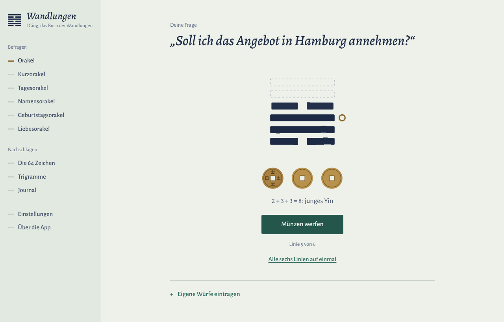
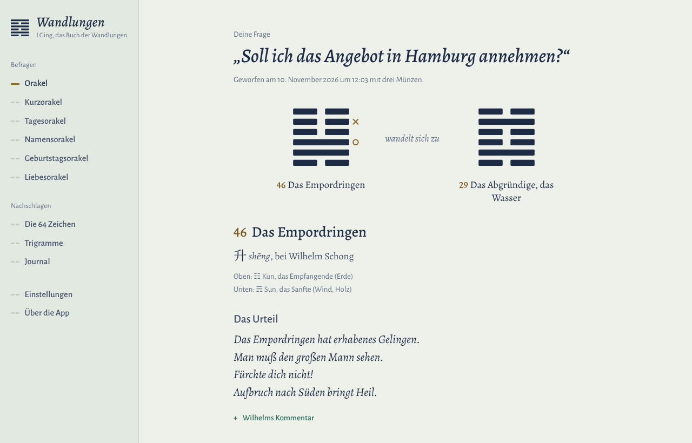

# Wandlungen

**Freie Open-Source-App für das I Ging, das Buch der Wandlungen, nach Richard Wilhelm.**
Läuft unter macOS, Windows, Linux, Android, iPhone und iPad sowie im Browser. Kein Konto, keine Werbung, vollständig offline.

*English below.*



## Funktionen

- **Orakel befragen** mit drei Münzen (animiert, Linie für Linie oder alle auf einmal), mit simulierter Schafgarbenmethode oder mit eigenen, echten Würfen
- **Deutung** mit Urteil, Bild, bewegten Linien und dem Zeichen, in das sich die Lage wandelt, dazu Wilhelms vollständiger Kommentar zum Aufklappen
- **Kurzorakel:** ein Zeichen ohne bewegte Linien
- **Tagesorakel:** ein Zeichen pro Tag, auf Wunsch persönlich
- **Namens-, Geburtstags- und Liebesorakel** nach der Pflaumenblüten-Methode (Meihua Yishu), mit nachvollziehbarer Rechnung
- **Alle 64 Zeichen** mit dem vollständigen Text Wilhelms, Suche, Trigramm-Tabelle, Kernzeichen, Umkehrung und Gegenzeichen
- **Die acht Trigramme** mit Bild, Eigenschaft und Familie
- **Journal:** Befragungen speichern, Notizen ergänzen, als JSON exportieren und importieren
- Deutsch und Englisch, helles und dunkles Design, sechs Hintergrundfarben, drei Textgrößen
- Keine Werbung, kein Tracking, keine Netzwerkverbindung



## Installieren

Fertige Dateien liegen unter [**Releases**](https://github.com/moonshroom303/i-ching/releases). Die Web-Version läuft unter <https://moonshroom303.github.io/i-ching/>, sobald GitHub Pages eingeschaltet ist.

| System | Datei | Hinweis |
|---|---|---|
| macOS (Apple Silicon) | `Wandlungen-…-mac-arm64.dmg` | siehe „macOS: erster Start“ |
| macOS (Intel) | `Wandlungen-…-mac-x64.dmg` | siehe „macOS: erster Start“ |
| Windows | `Wandlungen-…-Setup.exe` oder `…-Portable.exe` | SmartScreen: „Weitere Informationen“, dann „Trotzdem ausführen“ |
| Linux | `Wandlungen-…-linux-x86_64.AppImage`, `.deb` oder `.tar.gz` | AppImage vorher ausführbar machen: `chmod +x Wandlungen-*.AppImage` |
| Android | `Wandlungen-…-android.apk` | Installation aus dieser Quelle einmal erlauben |
| iPhone, iPad | Web-App oder `Wandlungen-…-ios-unsigned.ipa` | siehe „Android, iPhone und iPad“ |

**macOS: erster Start.** Die App ist nicht bei Apple notarisiert. Nach dem ersten Öffnungsversuch gehst du in
*Systemeinstellungen → Datenschutz & Sicherheit* und klickst bei Wandlungen auf **„Dennoch öffnen“**.
Alternativ im Terminal: `xattr -dr com.apple.quarantine /Applications/Wandlungen.app`

### Android, iPhone und iPad

Es gibt drei Wege, von einfach bis offiziell:

**1. Als Web-App (kostenlos, für alle Handys und Tablets).** Der Workflow `.github/workflows/pages.yml` stellt die App auf
GitHub Pages (einmalig unter *Settings → Pages → Source* „GitHub Actions“ wählen). Dann die Adresse öffnen und:
- **iPhone/iPad (Safari):** Teilen-Symbol → **„Zum Home-Bildschirm“**
- **Android (Chrome):** Menü ⋮ → **„App installieren“**

Die App bekommt ein eigenes Symbol, startet im Vollbild und funktioniert danach auch ohne Internet.

**2. Als echte App zum Installieren.**
- **Android:** `Wandlungen-…-android.apk` aufs Gerät laden und öffnen. Ohne eigenen Signaturschlüssel ist die APK
  mit einem wechselnden Testschlüssel signiert, ein Update erfordert dann Deinstallieren und Neuinstallieren (das Journal
  vorher exportieren). Mit eigenem Schlüssel (siehe unten) entstehen eine signierte APK und eine AAB für den Play Store.
- **iPhone/iPad:** Apple lässt Apps nur signiert auf Geräte. Die Datei `…-ios-unsigned.ipa` kannst du mit
  [Sideloadly](https://sideloadly.io) oder [AltStore](https://altstore.io) und deiner eigenen Apple-ID installieren
  (mit kostenloser Apple-ID läuft die Signatur nach 7 Tagen ab). Mit einem Mac geht es direkt: `npm run ios`,
  in Xcode unter *Signing & Capabilities* dein Team wählen und auf dem Gerät starten.

**3. Über die Stores.** Google Play braucht ein Entwicklerkonto (einmalig 25 US-Dollar) und die signierte AAB aus dem
Workflow. Der App Store braucht das Apple Developer Program (99 US-Dollar pro Jahr); hochgeladen wird aus Xcode.

**Eigener Android-Signaturschlüssel** (für Play Store und Updates ohne Neuinstallation):

```bash
keytool -genkey -v -keystore release.keystore -alias wandlungen -keyalg RSA -keysize 2048 -validity 10000
base64 -i release.keystore | pbcopy    # macOS; unter Linux: base64 -w0 release.keystore
```

Dann im GitHub-Repository unter *Settings → Secrets and variables → Actions* anlegen: `ANDROID_KEYSTORE_BASE64`,
`ANDROID_KEYSTORE_PASSWORD`, `ANDROID_KEY_ALIAS` (hier `wandlungen`) und `ANDROID_KEY_PASSWORD`.
Den Schlüssel gut aufbewahren: ohne ihn lassen sich im Play Store keine Updates mehr veröffentlichen.

**Ohne Installation:** `npm run build:web` erzeugt `dist-web/wandlungen.html`, eine einzige Datei, die in jedem
Browser läuft. Auch der Ordner `app/` funktioniert direkt als statische Website.

## Aus dem Quellcode starten

Voraussetzung: [Node.js](https://nodejs.org) 22 oder neuer.

```bash
npm install
npm start          # Desktop-App starten
npm test           # Tests ausführen
npm run android    # Android-Projekt öffnen (braucht Android Studio; beim ersten Mal vorher: npx cap add android)
npm run ios        # iOS-Projekt öffnen (braucht einen Mac mit Xcode; beim ersten Mal vorher: npx cap add ios)
```

## Installer bauen

**Desktop lokal** (jeweils auf dem passenden Betriebssystem):

```bash
npm run dist:mac     # .dmg für Apple Silicon und Intel
npm run dist:win     # Setup.exe und Portable.exe
npm run dist:linux   # AppImage, .deb, .tar.gz
```

Die Dateien landen in `dist/`.

### Alles automatisch bauen (empfohlen)

GitHub Actions baut alle Systeme auf GitHub-Servern, du brauchst dafür weder Mac noch Windows-PC:

1. Änderungen auf `main` pushen.
2. Version taggen und pushen:
   ```bash
   git tag v1.0.0
   git push origin v1.0.0
   ```
3. Der Workflow `.github/workflows/release.yml` baut macOS, Windows, Linux, Android und iOS und hängt alle Dateien an ein neues Release.
   Ohne Tag lässt er sich unter *Actions → Build and release → Run workflow* starten. Die Dateien liegen dann unter *Artifacts*.

Code-Signierung ist nicht eingerichtet. Wer ein Apple-Developer-Zertifikat hat, setzt in `package.json` bei `mac` die Zeile
`"identity": null` auf die eigene Identität und hinterlegt `CSC_LINK` und `CSC_KEY_PASSWORD` als GitHub-Secrets.

## Aufbau

```
app/                 die eigentliche App (HTML, CSS, JavaScript ohne Framework und ohne Build-Schritt)
  js/core.js         Orakel-Logik: Würfe, Wandlungen, King-Wen-Folge, Pflaumenblüten-Rechnung
  js/app.js          Oberfläche
  js/i18n.js         Texte der Oberfläche (de, en)
  data/              Texte der 64 Zeichen (de: Wilhelm 1924, en: CC0-Übersetzung)
  fonts/             Alegreya und Alegreya Sans (OFL)
  sw.js, manifest.webmanifest   Offline-Fähigkeit und Installation als Web-App
electron/main.js     Desktop-Hülle (Electron)
capacitor.config.json  Hülle für Android, iPhone und iPad (Capacitor); die Projekte android/ und ios/ entstehen beim Bauen
assets/              Quellbilder für App-Symbole und Startbildschirme der Handy-Apps
scripts/             Daten- und Web-Build, macOS-Signatur-Hook
test/                Unit-Tests (node --test)
.github/workflows/   Tests, Release-Builds für alle Systeme, Web-Version auf GitHub Pages
```

## Texte und Lizenzen

- **Quellcode:** MIT-Lizenz, siehe [LICENSE](LICENSE).
- **Deutscher Text:** Richard Wilhelm, *I Ging. Das Buch der Wandlungen*, Diederichs, Jena 1924. Gemeinfrei (Wilhelm † 1930).
  Digitalisat aus [johannes-kaindl/yijing](https://github.com/johannes-kaindl/yijing); Namen, Pinyin und die Linienfolge von
  Zeichen 39 und 40 wurden geprüft und berichtigt.
- **Englischer Text:** Übersetzung von Wilhelms Text aus [jesshewitt/i-ching](https://github.com/jesshewitt/i-ching), CC0 1.0.
- **Schriften:** Alegreya, Alegreya Sans, SIL Open Font License 1.1.

Details in [NOTICE.md](NOTICE.md). Die Daten lassen sich mit `scripts/build-data.mjs` aus den Quellen neu erzeugen
(Anleitung im Kopf der Datei).

---

## English

**Wandlungen** is a free, open-source I Ching app for macOS, Windows, Linux, Android, iPhone, iPad and the web, based on Richard Wilhelm's 1924
translation (public domain) with an English CC0 translation of Wilhelm's text. It offers the coin oracle (with an
animated casting stage, simulated yarrow stalks or your own throws), a quick oracle, a daily sign, name, birthday and
love oracles (Plum Blossom numerology), the complete text of all 64 hexagrams with commentary, the trigrams, and a
private journal with export and import. Everything stays on your device.

```bash
npm install && npm start   # run from source (Node.js 22+)
npm run dist               # build desktop installers for the current OS into dist/
npm run android            # open the Android project (first time: npx cap add android)
npm run ios                # open the iOS project in Xcode (first time: npx cap add ios)
git tag v1.0.0 && git push origin v1.0.0   # GitHub Actions builds all platforms and publishes a release
```

Phones and tablets: the `pages.yml` workflow publishes the web version on GitHub Pages; add it to the home screen
(Safari: Share → Add to Home Screen; Chrome: Install app) and it works offline. The release workflow also builds an
Android APK (signed AAB/APK when the `ANDROID_*` secrets are set) and an unsigned iOS IPA for sideloading with your own
Apple ID. App Store and Play Store publishing need the respective developer accounts.

macOS builds are not notarised: after the first launch attempt, open *System Settings → Privacy & Security* and click
**Open Anyway**. Source code: MIT. Texts: public domain / CC0. Fonts: OFL. See [NOTICE.md](NOTICE.md).
